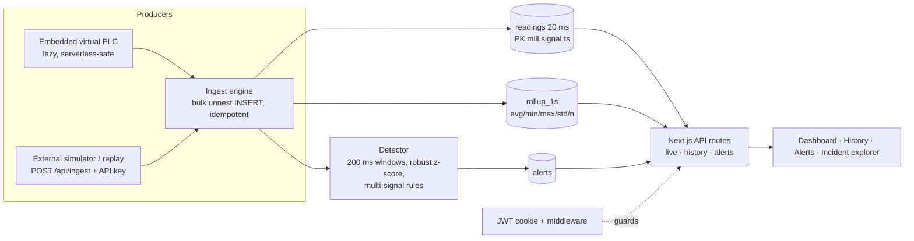

# Mono Edge · Signal Analytics Platform

Full-stack monitoring platform for a steel **rolling mill**: a virtual PLC emits 6 correlated signals at **20 ms (50 Hz)**, the platform ingests and stores them as time series, shows **live** and **historical** views, and raises **explainable anomaly alerts** (cobble detection) with an incident explorer.

| | |
|---|---|
| **Live app** | `<your-vercel-url>` |
| **Demo login** | `demo@monoedge.dev` / `Demo@12345` (or sign up) |
| **Stack** | Next.js 14 (App Router, TypeScript) · PostgreSQL (Neon) · JWT cookie auth · Recharts · Vercel |

## Quick start (local)

```bash
cp .env.example .env.local          # defaults work with the docker-compose DB below
docker compose up -d                # Postgres 16 on :5432
npm install
npm run db:init                     # creates tables (also done automatically on first request)
npm run seed -- --minutes 15        # demo user + 15 min of replayable history (incl. load change + cobble)
npm run dev                         # http://localhost:3000
npm test                            # detector / simulator unit tests
```

## The signal simulator (3 ways to run it)

1. **Embedded virtual PLC (default, zero setup).** While any user has the dashboard open, the server lazily generates the 20 ms samples since the last cursor, stores them and runs detection (`advanceSimulator` in `lib/engine.ts`). This is what makes it work on Vercel, which has no long-running worker. An advisory lock makes concurrent serverless calls safe.
2. **External simulator over the ingest API** (a realistic edge-gateway -> cloud path):
   ```bash
   # server: EMBEDDED_SIMULATOR=false
   npm run simulate -- --url http://localhost:3000 --key dev-ingest-key --mill RM-01,RM-02
   ```
3. **Replay history at speed** (re-visit the abnormal period through the full pipeline):
   ```bash
   npm run simulate -- --replay-from 2026-10-19T10:06:35Z --replay-to 2026-10-19T10:07:12Z --speed 20
   ```
   Replays are idempotent (`ON CONFLICT DO NOTHING`), so re-running creates no duplicate rows or alerts.

The generator is a **pure deterministic function of time** (`lib/simulator.ts`), so any period is exactly reproducible. Each 10-minute cycle contains:
- `+150 s` **legitimate load change**: speed setpoint +20 %, current +15 %, torque +10 %, force +8 %, temp +6 °C, 15 s ramps. Must **not** alert.
- `+420 s` **cobble** (3 s): current ×2.4, torque ×2.2, rolling force ×1.9, speed -20 %, vibration ×5.
- The **"Inject cobble"** button on the Live page schedules an extra cobble 2 s ahead, so reviewers can watch detection happen on demand.

## Architecture



**Data model.** `readings(mill_id, signal, ts, value, unit, quality)` with a composite PK (idempotency + range scans) and a BRIN index on `ts`; `rollup_1s` for wide ranges; `alerts` (kind, severity, window, signals[], reason, score, per-signal details JSON); `sim_state`, `scenario_events`, `users`.

**Why two resolutions.** 50 Hz x 6 signals x 2 mills = 600 rows/s. Charts never need that. Ranges <= 2 min are served from raw data downsampled to ~1000 points (avg/min/max per bucket); longer ranges come from 1 s rollups re-bucketed to ~800 points. Raw data is retained for `RAW_RETENTION_HOURS` **plus ±60 s around every alert**; rollups are kept 14 days. (In production this is a TimescaleDB hypertable with continuous aggregates + compression; the SQL is the same shape.)

**Security.** Middleware rejects every page/API call without a valid session (except `/login`, `/api/auth/*`); `/api/ingest` is protected by an API key; passwords are bcrypt-hashed; cookie is `httpOnly`, `sameSite=lax`, `secure` in production; all SQL is parameterised; ingest payloads are validated and capped at 20k rows.

## Anomaly detection approach (`lib/detector.ts`)

A **hybrid of statistics and domain rules**, deliberately explainable for plant engineers.

1. **Features:** 200 ms window means per signal.
2. **Adaptive baseline:** for each window, median and MAD of the previous ~10 s, ending 1 s ago. The lag keeps the incident out of its own baseline; using the median makes it robust to outliers; it follows slow legitimate drift. Scale is floored at 4 % of the baseline so very quiet signals don't hair-trigger.
3. **Robust z-score** per signal: `z = (x - median) / max(1.4826·MAD, 4 % · median)`.
4. **Rule A, cobble signature (critical):** `z(current) >= 4` **and** `z(torque) >= 4` **and** (`z(speed) <= -3` **or** `z(vibration) >= 5`) **and** at least 3 signals with `|z| >= 4`, persisting >= 2 windows (400 ms). Physically: the strip jams, so the motor draws far more current/torque while speed *collapses* and vibration bursts.
5. **Rule B, single-signal outlier (warning):** `|z| >= 8` for >= 4 windows not explained by Rule A (sensor fault, isolated process excursion).
6. **Alert record:** timestamp, end, affected signals, score, human-readable reason with % deviations, and a per-signal `{peak, baseline, pct, z}` JSON. Nearby detections of the same kind are merged (10 s) so one cobble = one alert.

**Why a legitimate load change is not an incident:** it raises speed *with* current/torque, slowly (15 s ramp), so the lagged baseline tracks it and the "surge + speed collapse" shape never appears. Verified by tests: a full cycle containing the load change and a cobble yields exactly **one** alert, at the cobble.

**Measured on the seeded data:** detection latency ≈ 1.2 s after onset (250 ms onset ramp + 400 ms persistence); the cobble shows +147 % current, +123 % torque, -20 % speed, ×4.9 vibration, up to 88 σ from normal; 0 false positives across normal operation and the load change.

**Limitations / next steps:** thresholds are hand-set (would be tuned per stand/product on labelled incidents); an Isolation Forest / autoencoder on the same window features could run *alongside* the rules to catch unknown patterns; stand-specific baselines per product/gauge; alert routing (Teams/PagerDuty); per-user rate limiting on auth.

## Deploying (Vercel + Neon, ~5 minutes)

1. Push this repo to GitHub.
2. Create a free **Neon** Postgres DB and copy its connection string (`...?sslmode=require`).
3. Import the repo in **Vercel** and set env vars: `DATABASE_URL`, `AUTH_SECRET` (`openssl rand -hex 32`), `INGEST_API_KEY`, `EMBEDDED_SIMULATOR=true`, `RAW_RETENTION_HOURS=1`.
4. Deploy, then seed the demo user + history **once** from your machine (note: seed truncates data tables):
   ```bash
   DATABASE_URL="<neon string>" npm run seed -- --minutes 15
   ```
5. Open the URL, sign in with the demo account.

## Project layout

```
app/                 pages (Live, History, Alerts, Alerts/[id], Login) + API routes
  api/{live,history,alerts,ingest,scenario,auth}/
lib/simulator.ts     deterministic virtual PLC     lib/detector.ts   pure anomaly detection
lib/engine.ts        ingest, rollups, alerts, embedded sim driver, retention
scripts/             init-db · seed · simulate (live + replay)       tests/  node:test unit tests
db/schema.sql        idempotent schema
```
