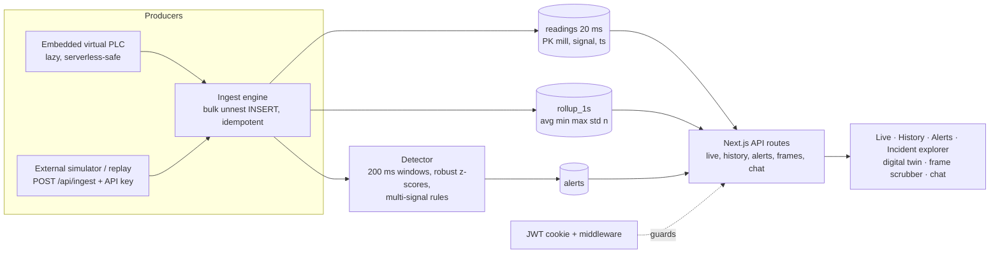

# Mono Edge · Signal Analytics Platform

A full-stack platform that turns **20 ms (50 Hz) rolling-mill PLC signals** into live monitoring, historical insight and **explainable anomaly alerts** (early warning → cobble), with an incident explorer, a digital twin and a plain-language chat assistant.

| | |
|---|---|
| **Live app** | `<LIVE_URL>` |
| **Source** | `<REPO_URL>` |
| **Demo login** | `demo@monoedge.dev` / `Demo@12345` |
| **Stack** | Next.js 14 (App Router, TypeScript) · PostgreSQL (Neon) · JWT-cookie auth · Recharts · Vercel |

---

## 1. Reviewer quick start (about 5 minutes)

> **Note on the live stream:** the virtual PLC runs *inside the server and advances while someone has the dashboard open* (this is what lets it work on Vercel, which has no background worker). If nobody looked for a while you will see a gap in history, exactly like a real data outage. Open **Live** and give it a few seconds.

1. **Sign in** with the demo account. (Creating a new account requires an **employee code**; use the demo login or the single-use code `<REVIEWER_CODE>`.)
2. **Live** — digital twin of the stand, status badge, six live signals. Switch between mills **RM-01 / RM-02**.
3. Click **Precursor → cobble**. After ~7 s the twin turns amber (*roll slip / chatter*) and an **early-warning alert** appears; at ~15 s the twin buckles red and a **critical cobble alert** follows. The cobble alert states how many seconds of notice the warning gave.
   - **Inject precursor** = a near miss: one warning, no cobble. **Inject cobble** = a sudden jam with no warning.
4. Open an alert (**Inspect →**) — *Incident explorer*:
   - **20 ms frame scrubber** (slider, ±20 ms step, play 0.1×–4×, jump to peak). The twin and a signal-by-signal table follow the selected frame.
   - *Normal vs incident* table, all-signals % change overlay, per-signal charts with the red alert window and the green "normal" line.
5. **History** — choose a mill, signals and a range (try *last 15 min*). Red bands are recorded alerts; the table compares **normal vs abnormal** periods. Look at the ramp around the scheduled *load change*: signals rise, **no alert is raised**.
6. **Alerts** — full alert history. Click the round chat button (bottom right) and try the suggested questions, e.g. *"Did we get any early warning before a cobble?"*.

---

## 2. Requirements coverage

| # | Requirement from the brief | How it is met | Where |
|---|---|---|---|
| 01 | **Authentication**, app only for authenticated users | Sign-up / sign-in with bcrypt-hashed passwords and an `httpOnly` JWT session cookie. Middleware rejects every page and API call without a valid session (except `/login`, `/api/auth/*` and the key-protected `/api/ingest`). Sign-up additionally requires a valid **employee code** (§3). | `middleware.ts`, `lib/auth.ts`, `app/api/auth/*` |
| 02 | **Signal generation & ingestion**: 20 ms readings, time-series stream, persisted | Deterministic virtual PLC (6 signals × 2 mills at 20 ms). Three producers share one pipeline: embedded lazy simulator, external simulator over HTTP, history replay. Bulk, **idempotent** inserts into Postgres, plus 1 s rollups. | `lib/simulator.ts`, `lib/engine.ts`, `app/api/ingest/route.ts`, `scripts/simulate.ts` |
| 03 | **Live dashboard**: status, live charts, select mill and signal | Polls `/api/live` every second; status badge (NORMAL / WARNING / ALARM / STALE), KPI cards, per-signal charts (50 Hz source downsampled to 250 ms buckets), mill and window selectors, signal toggles, alert shading. | `app/page.tsx`, `app/api/live/route.ts` |
| 04 | **Historical analytics** by signal and time range; compare normal vs abnormal | Mill / signal / time-range picker with presets. ≤ 2 min served from raw 20 ms data, longer ranges from 1 s rollups (up to 7 days). **Normal-vs-abnormal summary table** (mean ± σ, max, shift) and alerts in range. | `app/history/page.tsx`, `app/api/history/route.ts` |
| 05 | **Anomaly detection & alerts** with timestamp, affected signals, reason | Hybrid statistical + rule detector (§7). Alerts are persisted with start/end, affected signals, score, plain-English reason and per-signal deviations, and shown in the UI. | `lib/detector.ts`, `lib/engine.ts` |
| 06 | **Incident exploration**: alert history and signal behaviour around each incident | Alert list, incident page with normal-vs-incident comparison, overlay, per-signal charts and the **frame scrubber** on real stored 20 ms samples. | `app/alerts/**`, `components/FrameScrubber.tsx` |
| — | **Data & simulation**: normal operation, legitimate load change, abnormal event, replayable history | See §5. Cycle contains a legitimate +20 % load change (must **not** alert), an early-warning pattern and a cobble. Deterministic, so any period can be regenerated and replayed. | `lib/simulator.ts`, `scripts/seed.ts`, `scripts/simulate.ts` |
| — | **Submission**: GitHub, live URL, README (setup, simulator, architecture, detection), demo access | This file: §4 setup, §5 simulator, §6 architecture, §7 detection, §1 demo access, §13 deployment. | |

---

## 3. Beyond the brief

Features that go past what the assessment asked for:

- **Early-warning (precursor) detection with measured lead time.** A second, separate pattern (vibration and torque creeping up, speed sagging, *no* current surge) raises a *warning* seconds before a jam. When a cobble follows, its alert records *"early warning fired 7.8 s earlier"* and links to the warning.
- **Digital twin** of a 4-high stand: roll rotation follows motor speed, force arrows follow rolling force, the housing shakes with vibration, and the strip buckles when the data shows a cobble. The phase label (stable / heavy pass / precursor / cobble) is derived **only from signal values**, never from a scenario flag.
- **20 ms frame scrubber** on every incident, over the real stored raw samples (~500 frames around the alert) with step, play, speed control, jump-to-peak and click-to-seek.
- **On-demand scenarios** for reviewers: *Inject precursor*, *Inject cobble*, *Precursor → cobble* (escalation).
- **AI chat assistant** on the Alerts page (floating chat button). Answers questions about alerts and sensor history **from the database** in plain language for floor workers and visiting managers, shows clickable alert cards, and suggests follow-up questions.
  - **With a key:** Google Gemini function calling over five read-only, parameterised query tools (the model never writes SQL).
  - **Without a key (or if the AI service fails):** a built-in rule-based answerer uses the same tools, so the chat always works.
  - Per-user rate limit, input limits, login required, key kept server-side.
- **Employee-code gated sign-up.** Accounts can only be created with a code from the `employees` table. Codes are **single-use** and claimed *atomically* by the same SQL statement that creates the account (a failed sign-up does not burn the code; 6 simultaneous attempts → exactly one wins). Unknown / used / inactive codes all return one generic message, with an IP attempt limit. Manage codes with `npm run employees`.
- **Signed-in user shown in the navigation bar.**
- **Storage design:** raw 20 ms data + 1 s rollups, retention that keeps ±60 s around every alert, idempotent ingestion (replays never duplicate rows or alerts).
- **Test suite (20 tests)** covering the detector, simulator, twin phase logic, chat agent (including the LLM tool loop with a fake model) and sign-up concurrency.

---

## 4. Local setup

**Prerequisites:** Node.js 20+, and a PostgreSQL 14+ database (Docker, a native install, or a free Neon project).

```bash
git clone <REPO_URL> && cd mono-edge-signals
npm install
cp .env.example .env.local        # Windows PowerShell: copy .env.example .env.local
docker compose up -d              # Postgres 16 on :5432 (or point DATABASE_URL at your own DB)
npm run seed -- --minutes 15      # demo user + 15 min of replayable history (load change, precursor, cobble)
npm run dev                       # http://localhost:3000
npm test                          # 20 tests (DB-backed ones are skipped if DATABASE_URL is not set)
```

Tables are created automatically on the first request (or run `npm run db:init`). Sign in with the demo account created by the seed.

### Environment variables

| Variable | Purpose |
|---|---|
| `DATABASE_URL` | Postgres connection string (`...?sslmode=require` for Neon) |
| `AUTH_SECRET` | Signs session JWTs. **Set a long random value** (`openssl rand -hex 32`) |
| `INGEST_API_KEY` | Required `x-api-key` for `POST /api/ingest` |
| `EMBEDDED_SIMULATOR` | `true` (default) = the server generates the virtual PLC stream; `false` when using the external simulator |
| `RAW_RETENTION_HOURS` | Raw 20 ms data older than this is pruned (default `1`); rollups and ±60 s around alerts are kept |
| `PG_POOL_MAX` | Max DB connections per server instance (default 5; use 3 on serverless) |
| `GEMINI_API_KEY` | *Optional.* Enables the AI chat assistant. Without it the rule-based mode is used |
| `LLM_MODEL` | *Optional.* Gemini model name for the assistant |

### Employee codes

```bash
npm run employees -- list                                  # codes, owners, and who has used them
npm run employees -- add "Full Name" "Department"          # creates a new random single-use code
npm run employees -- deactivate EMP-XXXXXX
```

---

## 5. Signal simulator: start and replay

The generator is a **pure deterministic function of time** (`lib/simulator.ts`), so any period is exactly reproducible. Six correlated signals per mill at 20 ms: motor speed, motor current, torque, rolling force, vibration, temperature. Two mills, **RM-01** and **RM-02**; RM-02 runs 200 s earlier in the cycle so the two never alarm together.

Each **10-minute cycle**:

| Cycle time | Event | Signal behaviour | Expected result |
|---|---|---|---|
| continuous | Normal operation | Stable values with slow oscillation and noise | no alert |
| +150 s | **Legitimate load change** | Speed +20 %, current +15 %, torque +10 %, force +8 %, temperature +6 °C, 15 s ramps, 60 s hold | **no alert** |
| +408 s | **Precursor** (12 s build-up) | Vibration up to ~×2.8 with ~7 Hz chatter, torque +16 %, force +12 %, speed −6 %, current only +10 % | ⚠ *warning* alert |
| +420 s | **Cobble** (5 s) | Current ×2.5, torque ×2.3, force ×2.0, speed −20 %, vibration ×6 | 🔴 *critical* alert with lead time |

**Three ways to run it** (all use the same ingest pipeline):

1. **Embedded virtual PLC (default).** While a dashboard is open, the server generates the 20 ms samples since the last cursor, stores them and runs detection. An advisory lock makes concurrent serverless calls safe.
2. **External simulator over the ingest API** (a realistic gateway-to-cloud path):
   ```bash
   # server: EMBEDDED_SIMULATOR=false
   npm run simulate -- --url http://localhost:3000 --key <INGEST_API_KEY> --mill RM-01,RM-02
   ```
3. **Replay history at speed** (revisit the abnormal period and watch the alert get created):
   ```bash
   npm run simulate -- --replay-from 2026-10-19T10:06:35Z --replay-to 2026-10-19T10:07:12Z --speed 20
   ```
   Replays are idempotent: re-running creates no duplicate rows or alerts. Include at least ~12 s of lead-in before an event so the detector has a baseline.

`npm run seed -- --minutes 15` generates and ingests history for both mills through the same code path (including detection). *Note: the seed truncates readings, rollups and alerts (not users or employees).*

---

## 6. Architecture



**Data model** (`db/schema.sql`)

| Table | Purpose |
|---|---|
| `readings(mill_id, signal, ts, value, unit, quality)` | Raw 20 ms samples. Composite PK = idempotency + range scans; BRIN index on `ts` |
| `rollup_1s(mill_id, signal, bucket, avg, min, max, std, n)` | 1 s aggregates for wide ranges, kept 14 days |
| `alerts(...)` | kind, severity, window, affected signals, reason, score, per-signal details (JSON incl. lead time), status |
| `users`, `employees` | Accounts and the single-use employee codes they claimed |
| `sim_state`, `scenario_events` | Embedded-simulator cursor and operator-injected scenarios |

**Key design decisions**

- **Two resolutions.** 2 mills × 6 signals × 50 Hz = 600 rows/s. Charts never need that, so ranges ≤ 2 min read raw data downsampled to ~1000 points; longer ranges read 1 s rollups re-bucketed to ~800 points (weighted mean, true min/max). In production this maps to a TimescaleDB hypertable with continuous aggregates and compression.
- **Idempotent, replayable ingestion.** `ON CONFLICT DO NOTHING` on the primary key; detection re-runs over the affected range plus 12 s of baseline context; overlapping detections merge into one alert.
- **Serverless-friendly.** No long-running worker: the virtual PLC is cursor-based and advanced lazily under an advisory lock; an external simulator covers the "real gateway" path.
- **Retention.** Raw data is pruned after `RAW_RETENTION_HOURS`, **except ±60 s around every alert**, so any incident stays fully replayable.
- **Read-only AI tools.** The chat assistant can only call five parameterised query functions (alert summary, alert list, alert detail, signal stats, current status).

---

## 7. Anomaly-detection approach (`lib/detector.ts`)

A **hybrid of statistics and domain rules**, deliberately explainable to plant engineers. The detector is a pure function (no I/O) and is unit-tested.

1. **Features:** 200 ms window means per signal.
2. **Adaptive baseline:** for each window, the **median and MAD** of the previous ~10 s, *ending 1 s ago*. The lag keeps the incident out of its own baseline; the median is robust to outliers; it follows legitimate slow drift. The scale is floored at 4 % of the baseline so very quiet signals cannot hair-trigger.
3. **Robust z-score** per signal: `z = (x − median) / max(1.4826·MAD, 4 % · median)`.
4. **Rule A: cobble signature (critical).** `z(current) ≥ 4` **and** `z(torque) ≥ 4` **and** (`z(speed) ≤ −3` **or** `z(vibration) ≥ 5`) **and** ≥ 3 signals with `|z| ≥ 4`, for ≥ 2 windows (400 ms). *Physically: the strip jams, so the motor draws far more current and torque while speed collapses and vibration bursts.*
5. **Rule C: cobble precursor (warning).** `z(vibration) ≥ 5` **and** `z(torque) ≥ 2` **and** `z(speed) ≤ −1`, with **no current surge**, for ≥ 5 windows (1 s). *Early roll slip / chatter.*
6. **Rule B: single-signal outlier (warning).** One signal `|z| ≥ 8` for ≥ 4 windows **while every other signal stays within |z| < 2** (an isolated excursion or sensor fault; multi-signal patterns belong to A and C).
7. **Alert record:** timestamp, end, affected signals, score, plain-English reason with % deviations, per-signal `{peak, baseline, pct, z}`, and for cobbles the lead time since the warning.

**Why a legitimate load change is not an incident:** it moves speed *up together with* current and torque, slowly (15 s ramp), so the lagged baseline tracks it and the "surge with speed collapse or vibration burst" shape never appears.

**Measured on the deterministic simulator** (3 full cycles × 2 mills = 60 min of data including 6 legitimate load changes):

| Metric | Result |
|---|---|
| Alerts raised | **12 = exactly 1 warning + 1 critical per cycle per mill; 0 false positives** |
| Cobble alert start vs true onset | within one 200 ms window (confirmation needs 2 consecutive windows = 0.4 s) |
| Early-warning lead time before the cobble alert | **7.6 – 8.8 s** |
| Cobble deviation vs 10 s baseline | current **+153 %**, torque **+126 %**, force **+96 %**, speed **−20 %**, vibration **+521 %**; up to z = 43 |
| Ingestion throughput (local Postgres, one process) | **~47 000 rows/s** end-to-end (generate + insert + rollup + detect) vs 600 rows/s required |

*The data is synthetic: these figures show the detector separates the designed patterns, not performance on real plant data.*

---

## 8. Testing

```bash
npm test      # 20 tests
```

Covers: simulator determinism; full cycle gives exactly one warning then one cobble with ≥ 4 s lead and **no alert on the load change**; stand-alone precursor (near miss) raises no cobble; operator-injected cobble and escalation; **batch-boundary safety** (a detection window cut mid-event never leaks a spurious outlier); a genuine isolated sensor spike still alerts; twin phase derivation; chat agent (LLM tool loop with a fake model, rule answers, off-topic handling); sign-up requires a valid unused employee code and **concurrent claims allow exactly one winner**.

---

## 9. API reference

All endpoints require a session cookie unless noted.

| Endpoint | Purpose |
|---|---|
| `POST /api/auth/register` `{email, password, employeeCode}` | Create account (employee code required), sets session |
| `POST /api/auth/login` · `POST /api/auth/logout` · `GET /api/auth/me` | Session management *(open)* |
| `POST /api/ingest` | Batch of readings (≤ 20 000) with header `x-api-key` *(key-protected, not cookie)* |
| `GET /api/live?mill=RM-01&seconds=60` | Downsampled live series, latest values, status, latest alerts |
| `GET /api/history?mill&signals&from&to` | Raw or rollup series, alerts in range, normal-vs-abnormal summary |
| `GET /api/alerts` · `GET/PATCH /api/alerts/:id` | Alert list; incident context and normal-vs-incident comparison; acknowledge |
| `GET /api/alerts/:id/frames` | Raw 20 ms frames around an alert (for the scrubber) |
| `POST /api/scenario` `{mill, kind}` | Inject `precursor`, `cobble` or `escalation` into the embedded simulator |
| `GET/POST /api/chat` | Chat assistant (suggestions / answer) |

Ingest payload (readings may be mixed across mills and signals):

```json
{ "readings": [ { "mill_id": "RM-01", "signal": "motor_current", "timestamp": "2026-10-19T10:00:00.020Z", "value": 126.5, "unit": "A" } ] }
```

---

## 10. Project structure

```
app/                  pages (Live, History, Alerts, Alerts/[id], Login) and API routes
components/           DigitalTwin · FrameScrubber · SignalChart · ChatAgent · Nav
lib/simulator.ts      deterministic virtual PLC        lib/detector.ts   pure anomaly detection
lib/engine.ts         ingest, rollups, alerts, embedded simulator driver, retention
lib/chat/             assistant: tools (SQL), agent (LLM + rules), plain-language helpers
lib/auth.ts, db.ts    sessions, employee-code sign-up, pool and schema bootstrap
scripts/              seed · simulate (live + replay) · employees · init-db
tests/                detector, chat, sign-up
db/schema.sql         idempotent schema
```

---

## 11. Security notes

- Passwords hashed with bcrypt; `httpOnly`, `sameSite=lax` session cookie (`secure` in production); all SQL parameterised; ingest payloads validated and capped.
- `/api/ingest` is protected by an API key; `/api/chat` and all data endpoints require a session.
- The AI assistant gets read-only, validated query tools only; its API key never leaves the server.
- **In production always set `AUTH_SECRET` and `INGEST_API_KEY`.** When unset, the code falls back to development defaults that are visible in this repository.
- Rate limits (chat, sign-up attempts) are in-memory and therefore per server instance (best effort on serverless).

## 12. Limitations and next steps

- Synthetic data: thresholds are hand-set from the simulator's physics and would be tuned on labelled plant incidents.
- Add an unsupervised model (Isolation Forest / autoencoder) alongside the rules to catch unknown patterns; per-stand and per-product baselines.
- A **long** cobble (more than ~6 s) lets the adaptive baseline drift toward the fault; freezing the baseline while an alert is active is the planned fix.
- At real scale: Kafka (partitioned by mill) → Spark/Flink windowing → TimescaleDB/ClickHouse; alert routing (Teams / PagerDuty); RBAC and refresh tokens; per-user rate limiting in a shared store.
- The virtual PLC advances only while the dashboard is open (by design for serverless); an external simulator provides a continuous stream.

---

## 13. Deployment considerations (Vercel + Neon)

### Steps

1. **Neon:** create a project in a region close to your Vercel function region. Click **Connect**, turn **Pooled connection off** and copy the **direct** string ending in `?sslmode=require`. *(The embedded simulator uses a session-level advisory lock, which pooled/PgBouncer connections can handle badly.)*
2. **Verify locally against Neon:** put the string in `.env.local`, run `npm run seed` and `npm run dev`, and confirm the Live page keeps updating. Then switch `.env.local` back to your local DB.
3. **Vercel:** import the GitHub repo (Next.js is auto-detected; if `package.json` is not at the repo root, set *Root Directory*). Add these **Production** environment variables *before* the first deploy:

   | Variable | Value |
   |---|---|
   | `DATABASE_URL` | Neon direct connection string |
   | `PG_POOL_MAX` | `3` |
   | `AUTH_SECRET` | long random string |
   | `INGEST_API_KEY` | another random string |
   | `EMBEDDED_SIMULATOR` | `true` |
   | `RAW_RETENTION_HOURS` | `1` |
   | `GEMINI_API_KEY`, `LLM_MODEL` | optional (chat assistant) |

4. Set **Settings → Functions → Region** to match Neon, then **Deploy**.
5. **Seed once** from your machine (PowerShell shown):
   ```powershell
   $env:DATABASE_URL="postgresql://...neon.tech/neondb?sslmode=require"
   npm run seed -- --minutes 15
   npm run employees -- add "Reviewer" "Hiring"     # optional single-use sign-up code
   Remove-Item Env:DATABASE_URL
   ```
6. **Smoke-test in an incognito window:** sign in, Live updates, *Precursor → cobble* raises both alerts, incident page and scrubber open, History shows data, chat answers. Check Vercel function logs for errors.

### Things to consider

- **Secrets.** Never commit `.env.local`; never prefix variables with `NEXT_PUBLIC_`; set `AUTH_SECRET` and `INGEST_API_KEY` (otherwise public development defaults apply); rotate any key that was ever shared or committed. Redeploy after changing an environment variable.
- **Cold starts.** Neon suspends idle databases and the first dashboard visit catches up on up to 2 minutes of simulated data, so the first load can be slow. If you see 504 timeouts, lower `MAX_CATCHUP_MS` in `lib/engine.ts` (e.g. to 30 000).
- **Storage.** The free tier is 0.5 GB. The simulator writes ~600 rows/s only while someone is viewing; raw data is pruned after `RAW_RETENTION_HOURS` (set `0.5` if storage grows). Watch the Neon dashboard after a day.
- **Stale history.** Seeded history is relative to *when you seeded*. After days idle, History looks empty until someone opens Live; re-seed shortly before reviewers look, but remember the seed wipes readings and alerts.
- **Employee codes.** Codes live in the `employees` table. Do not publish real ones; hand reviewers the demo login or a dedicated single-use code. Deactivated codes stay in the table.
- **AI assistant.** Optional. Without `GEMINI_API_KEY`, or if the provider errors or rate-limits (HTTP 429), the assistant silently falls back to the rule-based mode (a note appears under the answer). With a "thinking" model, a low output-token cap can truncate answers; raise `maxOutputTokens` if replies come back empty.
- **External simulator in production.** If you use `npm run simulate` against the deployed URL, set `EMBEDDED_SIMULATOR=false` so the two producers do not write the same mill.
- **Auto-deploys.** Every push to the production branch redeploys; avoid pushing broken code after sharing the link.

### Troubleshooting

| Symptom | Likely cause |
|---|---|
| `DATABASE_URL is not set` | Variable missing for *Production*, or no redeploy after adding it |
| SSL / `pg_hba` error | Connection string missing `?sslmode=require` |
| Login keeps returning to the login page | `AUTH_SECRET` missing or changed between deploys |
| Live shows `STALE` / no data | Simulator not advancing: check function logs, use the *direct* Neon string, `EMBEDDED_SIMULATOR=true` |
| Chat answers carry "basic answer" note | Wrong/expired AI key or model name; look for `[chat] LLM failed` in the logs |
| Build fails on Vercel | Run `npm run build` locally to reproduce |
